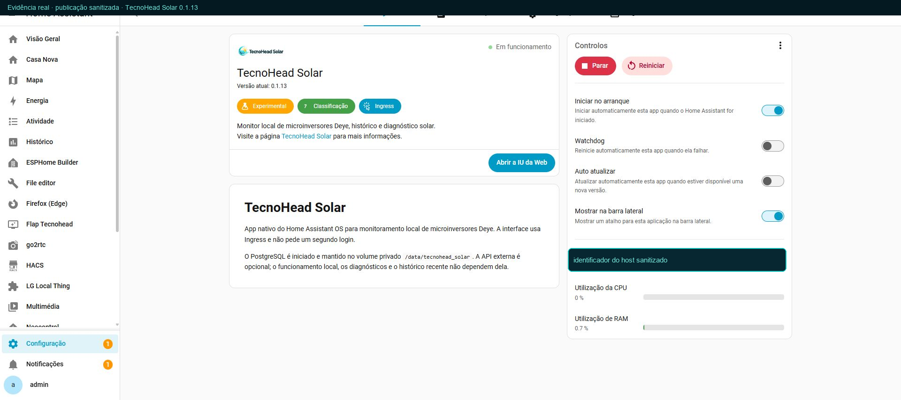
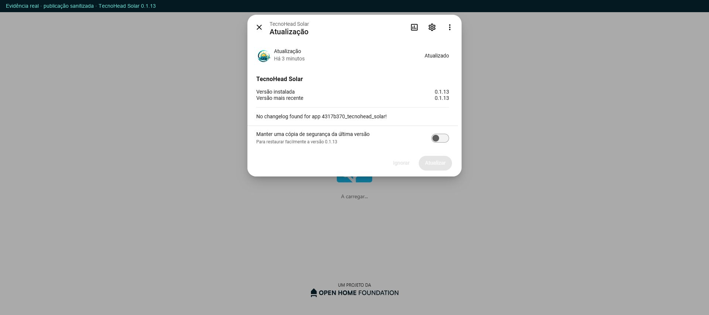
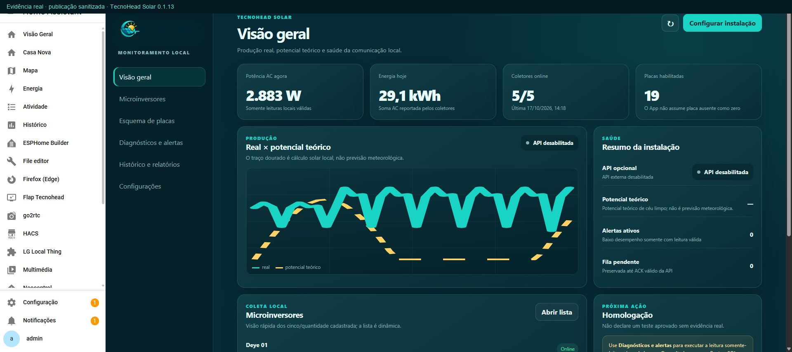
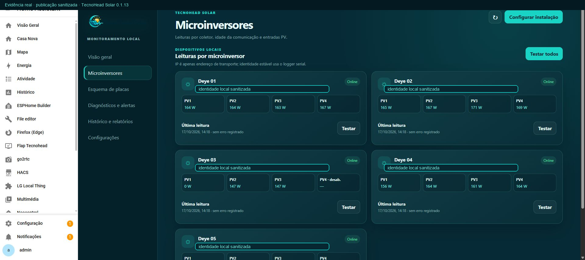
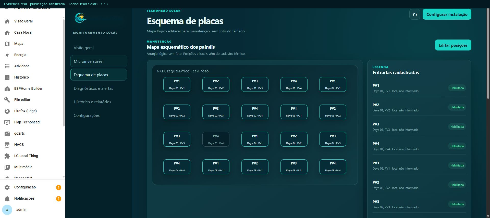
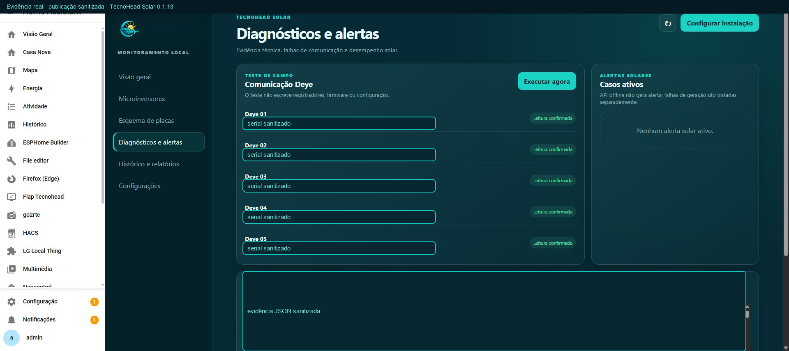
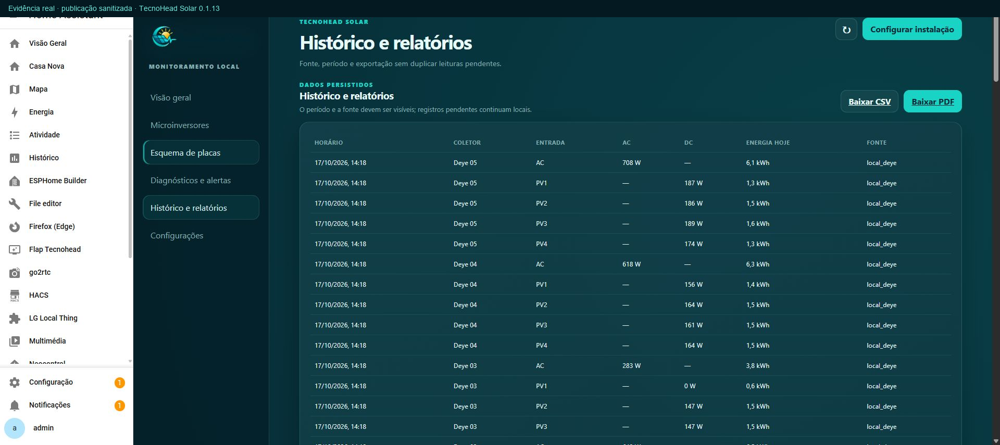
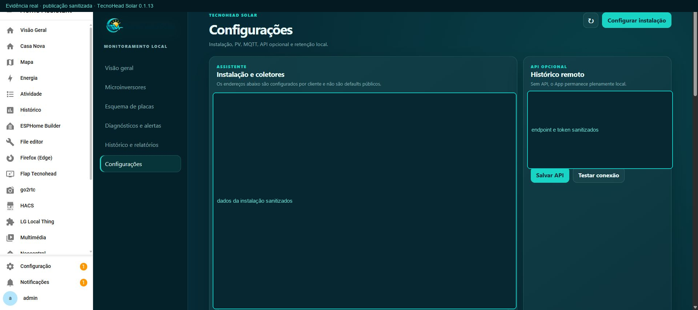

# Capturas reais sanitizadas

As imagens abaixo foram capturadas da instalação real no Home Assistant OS em 17/10/2026, após a atualização para 0.1.13. IPs, seriais de logger/inversor, coordenadas, identificador do host, endpoint privado e payload JSON foram cobertos; os estados, contagens e medições de operação continuam sendo evidência real.

| Tela | Evidência |
|---|---|
| Instalação no Supervisor |  |
| Modal de atualização |  |
| Visão geral |  |
| Microinversores |  |
| Esquema técnico das placas |  |
| Diagnósticos e alertas |  |
| Histórico e relatórios |  |
| Configurações |  |

Os arquivos-fonte das capturas permanecem fora do repositório. O script [`scripts/sanitize_screenshots.py`](../../scripts/sanitize_screenshots.py) reproduz a camada de sanitização a partir dos arquivos temporários locais sem inserir credenciais ou dados residenciais no GitHub.
